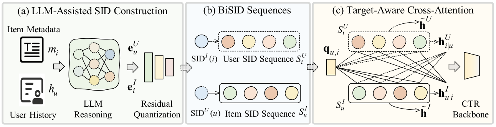

# BiSID-CTR

Bidirectional Semantic ID Sequences for Click-Through Rate Prediction.

<p align="center">
  
</p>

<p align="center">
  <em>(a) LLM profiling and residual quantization yield item/user SIDs.
  (b) User-side item SIDs and item-side user SIDs, truncated to time &lt; t.
  (c) Target-pair query, then cross-attention; four vectors enter the CTR backbone.</em>
</p>

## Setup

```bash
conda create -n bisid python=3.10
conda activate bisid
pip install -r requirements.txt
```

Amazon Reviews 2023 jsonl (https://amazon-reviews-2023.github.io/):

```text
data/gift/meta_Gift_Cards.jsonl
data/gift/Gift_Cards.jsonl
data/game/meta_Video_Games.jsonl
data/game/Video_Games.jsonl
data/music/meta_Digital_Music.jsonl
data/music/Digital_Music.jsonl
```

MovieLens-1M (https://grouplens.org/datasets/movielens/1m/):

```text
data/ml1m/ml-1m/ratings.dat
data/ml1m/ml-1m/users.dat
data/ml1m/ml-1m/movies.dat
```

Amazon: 5-core, rating ≥ 4 as positive, timestamp split 8:1:1.  
MovieLens-1M: drop rating == 3, then >3 as positive, same split.

## Data

```powershell
cd data/gift
python process.py
cd ../..
python data/build_profiles.py --data_dir data/gift
python data/build_sids.py --data_dir data/gift
python data/prepare_bisid.py --data_dir data/gift
```

Requires `LLM_API_KEY` or `DASHSCOPE_API_KEY`. Without an API (`-LLM`):

```powershell
python data/build_profiles.py --data_dir data/gift --skip_llm
python data/build_sids.py --data_dir data/gift --hash_embed
python data/prepare_bisid.py --data_dir data/gift
```

MovieLens-1M (`UserID` / `MovieID` / `Timestamp`):

```powershell
python data/ml1m/process.py
python data/build_profiles.py --data_dir data/ml1m
python data/build_sids.py --data_dir data/ml1m
python data/prepare_bisid.py --data_dir data/ml1m --user_col UserID --item_col MovieID --time_col Timestamp
```

`scripts/prepare_domain.ps1 -Domain gift|game|music|ml1m` runs the same steps.

| Variable | Default |
| --- | --- |
| `LLM_API_KEY` / `DASHSCOPE_API_KEY` | — |
| `LLM_BASE_URL` | DashScope compatible mode |
| `LLM_MODEL` | `qwen3-max` |
| `EMBED_MODEL` | `text-embedding-v4` |

## Training

From `ctr/`. Replace `gift` with `game`, `music`, or `ml1m`.

```powershell
python run_expid.py --config ./config --expid DeepFM_gift --gpu 0
python run_expid.py --config ./config --expid DIN_gift --gpu 0
python run_expid.py --config ./config --expid BST_gift --gpu 0
python run_expid.py --config ./config --expid TIN_gift --gpu 0
python run_expid.py --config ./config --expid SIDFeat_gift --gpu 0
python run_expid.py --config ./config --expid SIDCTR_gift --gpu 0
python run_expid.py --config ./config --expid BiSIDCTR_gift --gpu 0
```

Defaults: batch 1024, lr 0.001, hidden 128, 4 heads, sequence length 20, SID length 3, patience 10, Adam (dense) + FTRL (sparse).

Ablations: `woUS` / `woIS` drop one sequence; `woXA` target-aware pooling only; `woTA` cross-attention only; `AID` atomic IDs.

```powershell
python run_expid.py --config ./config --expid BiSIDCTR_gift_woUS --gpu 0
python run_expid.py --config ./config --expid BiSIDCTR_gift_woIS --gpu 0
python run_expid.py --config ./config --expid BiSIDCTR_gift_woXA --gpu 0
python run_expid.py --config ./config --expid BiSIDCTR_gift_woTA --gpu 0
python run_expid.py --config ./config --expid BiSIDCTR_gift_AID --gpu 0
```

```text
data/        preprocess, SID construction
sid/         LLM client, RQ-KMeans
ctr/         training
ctr/config/  dataset and model configs
figures/     framework figure
scripts/     helpers
```
